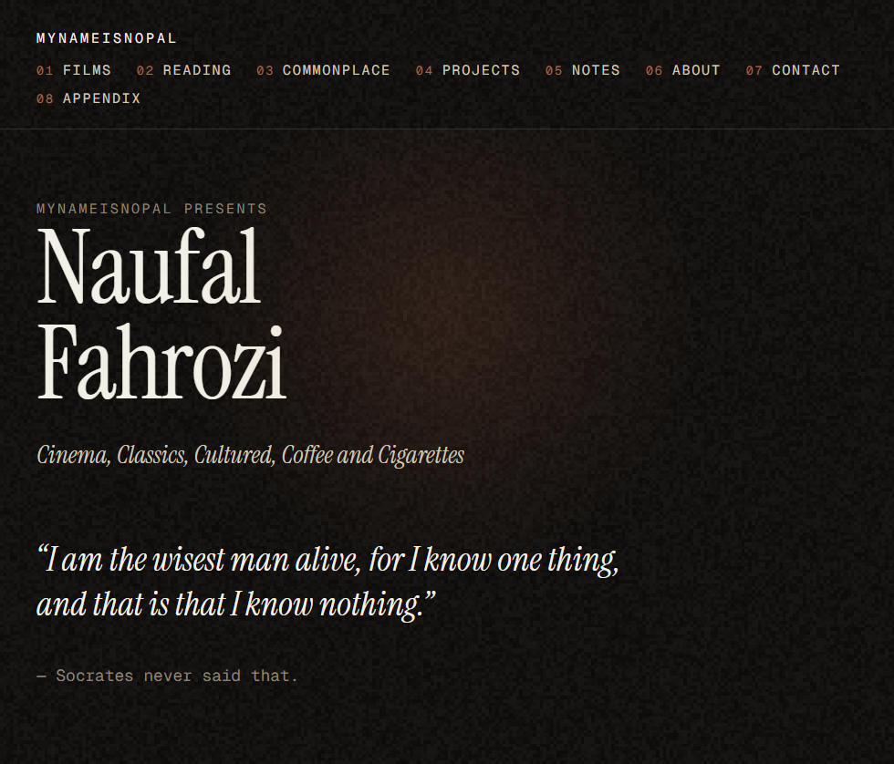
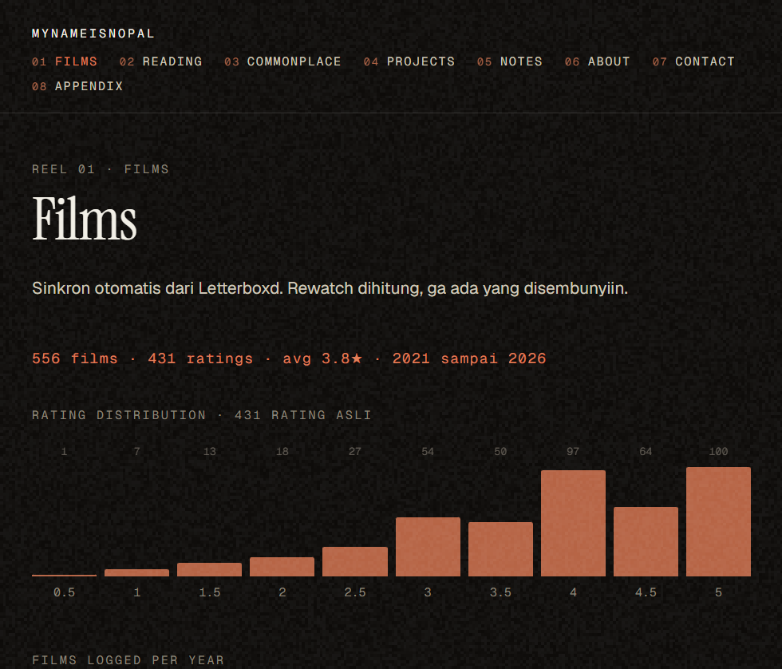
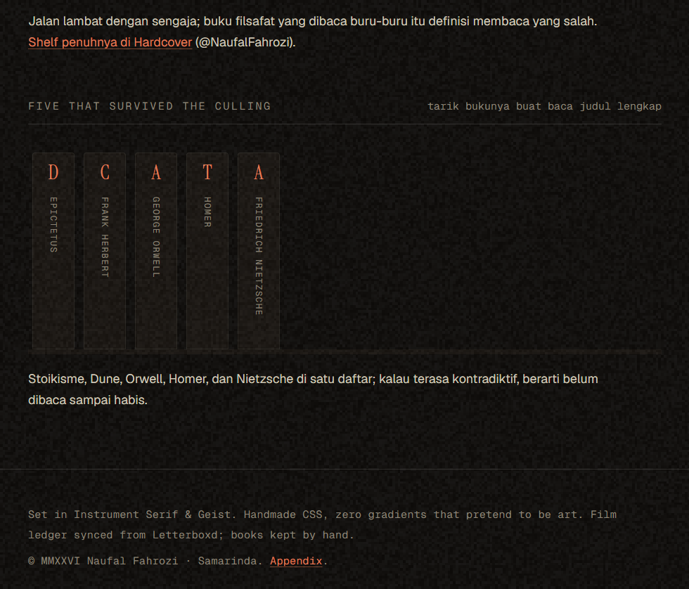
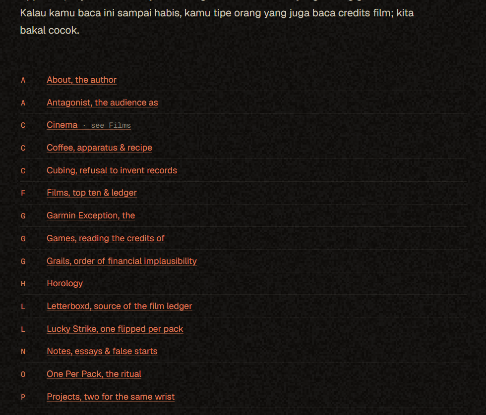

# mynameisnopal

**Cinema, Classics, Cultured, Coffee and Cigarettes.**
The personal site of Naufal Fahrozi · [mynameisnopal.vercel.app](https://mynameisnopal.vercel.app)



Not a portfolio. A **projection room**: dark auditorium, one warm beam, live film grain, and
everything numbered as reels.

[](https://github.com/NaufalFahrozi/mynameisnopal/actions/workflows/sync-letterboxd.yml)


## The program

| Reel | Page | The device |
| --- | --- | --- |
| 01 | [Films](https://mynameisnopal.vercel.app/films) | two charts built from a real Letterboxd export, plus a "putar reel" button |
| 02 | [Reading](https://mynameisnopal.vercel.app/reading) | a shelf of spines that pull out when you hover |
| 03 | [Commonplace](https://mynameisnopal.vercel.app/commonplace) | a toggle that refuses to be a smartwatch |
| 04 | [Projects](https://mynameisnopal.vercel.app/projects) | a one-tap demo of SebatSense |
| 05 | [Notes](https://mynameisnopal.vercel.app/notes) | essays with marginal notes |
| 06 | [About](https://mynameisnopal.vercel.app/about) | "AUDITED" stamps on hover |
| 07 | [Contact](https://mynameisnopal.vercel.app/contact) | the email copies itself |
| 08 | [Appendix](https://mynameisnopal.vercel.app/appendix) | an A to Z rail, and one dead link that glitches on purpose |





## How it works

- **Astro 7** + TypeScript (strict) + MDX. Static output, no client framework.
- **Handmade CSS.** Design tokens live at the top of `src/styles/global.css`. No CSS framework, ever.
- **The Letterboxd pipeline.** The RSS feed is fetched at build time; a committed cache is the
  fallback so builds never break; a GitHub Action refreshes the cache daily and triggers a
  redeploy, so the film ledger stays current without anyone touching it.
- **The archive.** `scripts/build-archive.mjs` turns a Letterboxd export into
  `src/data/letterboxd-archive.ts` (556 films and 431 ratings at the time of writing).

```bash
npm install
npm run dev      # local preview at http://localhost:4321
npm run build    # production build
npm run sync     # refresh the Letterboxd cache
```

## House rules

This repository has opinions, and they are enforced:

1. **No em dashes, except in quote attributions.** The author's call, and yes, the irony is noted:
   `— Socrates never said that`
2. **No posters, no marquee, no sound, no end credits, no sprocket bars.** All were tried and vetoed.
3. **Verdict, not diary.** Minimal first person, zero over-exposition.
4. **Show, never claim.** The site never says it is smart.
5. **Mobile is first-class.** 360px or it does not ship.

Context for contributors and future agents: [AGENTS.md](./AGENTS.md).
The satirical lines, pending author review: [SATIRE.md](./SATIRE.md).

---

Set in Instrument Serif & Geist · One screen, one beam, one grain · Built slowly, in Samarinda.
